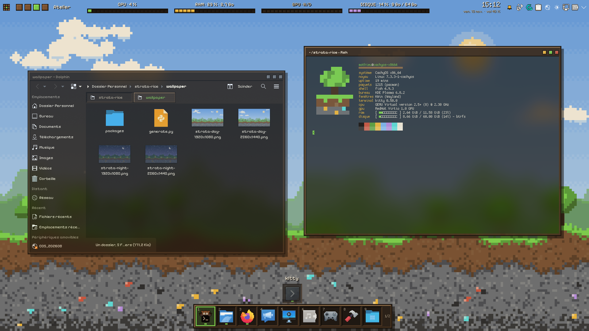
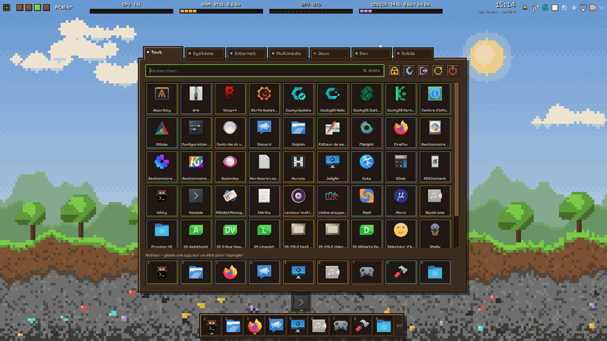
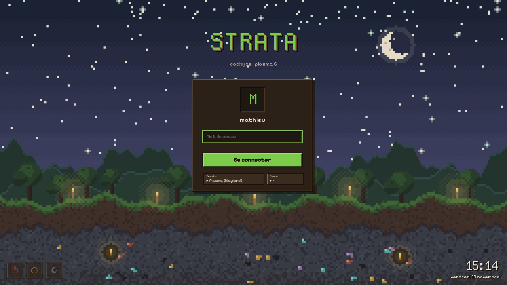
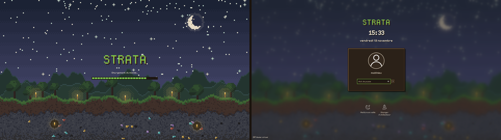

# Strata — rice KDE Plasma 6

Rice **original** inspiré des jeux de blocs (bois, herbe, terre, pierre, slots d'inventaire). Aucune ressource issue d'un jeu existant : textures, polices, icônes et fonds sont dessinés ou générés pour Strata.









## Installation

Depuis un terminal de la session Plasma (Wayland), CachyOS / Arch :

```sh
curl -fsSL https://raw.githubusercontent.com/MathieuRDG/strata-rice/main/boot.sh | bash
```

- Clone dans `~/.local/share/strata` puis lance `install.sh` ; relancer la commande = mise à jour.
- Options : `… | bash -s -- --with-sddm` (écran de connexion, sudo), `--reset-layout`, `--no-packages`, `--no-snapshot`.
- Avant toute modification : snapshot snapper de `/` et `/home` (si configurés) + archive de la configuration d'origine (`~/.local/state/strata/backup-initial/`). Retour arrière : `PORTAGE.md` § 8.
- Réglages : `~/.local/share/strata/strata.conf`, puis `./install.sh`. Détails machine cible : `PORTAGE.md`.
- Se déconnecter / reconnecter une fois à la fin.

## Contenu

- `backup/` (non versionné) : état d'origine de `~/.config` de la VM de développement
- `fonts/` : Pixelify Sans (OFL), Cozette (MIT) + règle fontconfig
- `wallpaper/` : générateur de paysage pixel jour/nuit (Python pur)
- `colors/`, `kvantum/` : jeu de couleurs et thème Kvantum (générateur SVG)
- `aurorae/`, `kwin/` : décoration, règles d'opacité, scripts KWin (plein écran, Meta+1…9)
- `terminal/` : kitty, prompt fish, fastfetch
- `plasma/` : Plasma Style (générateur SVG), `tools/pixsvg.py` : moteur commun
- `plasmoids/` : barres d'infos, hotbar, inventaire, notifications + OSD
- `lookandfeel/` : splash, écran de verrouillage
- `sddm/` : écran de connexion
- `scripts/` : disposition des panneaux, écrans, correctifs
- `PACKAGES.md` : paquets et ressources installés
